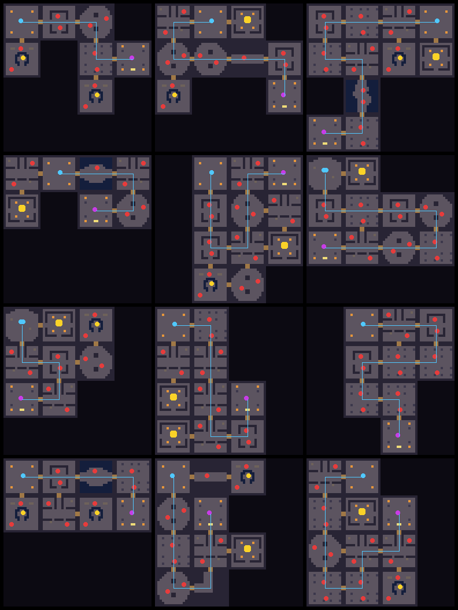

# 03 — Level generation

> DRAFT SPEC. **The oracle is executable:** `tools/dungeons/levelgen.py` and
> `tools/dungeons/prng.py`. The ROM must reproduce the oracle **byte for
> byte**: same map, same spawn table, same draw count. Pinned by
> `tests/test_dungeons_model.py`. If this text and the oracle disagree, the
> oracle is the contract and this text is the bug.
>
> Preview: `python3 tools/dungeons/render_preview.py out.png [seeds...]`
> draws floors. `img/levelgen_preview.png` shows 4 seeds × floors 0/4/8.

*Cyan line: the critical path. Red: enemy packs. Yellow: chests. Violet:
boss. Pale: exit stairs. Orange: braziers. Navy: chasm.*

## 1. Shape: authored rooms stitched along a generated spine

This is the genre reference's own hybrid. Its designers place hand-built
rooms and let the engine arrange them, because "procedural generation doesn't
take into account pacing" (research §B). The macro structure is the classic
room-grid-with-solution-path generator (research §C), generalised from
left/right/down exits to a 4-bit **N/E/S/W door mask**.

Rejected alternatives:

- **BSP and cellular automata.** They produce shapes that fight pre-drawn
  chunk art. Cellular automata also needs an 8 KB double buffer.
- **Per-tile noise.** Pacing becomes luck.

## 2. Data

### 2.1 The floor

- A **4×4 grid of cells**.
- Each cell is **16×16 metatiles**, and each metatile is 16×16 px.
- The floor is therefore 64×64 metatiles = 4,096 B of WRAM = exactly the
  64×64 `tiles16` BG1 tilemap (02 §1).
- Index: `my * 64 + mx`, which is two shifts and an OR.

### 2.2 The PRNG

- xorshift16, triple (7, 9, 8). Full period 65,535, verified by test.
- The golden sequence from state 1 is `$8181, $6021, $E999, $2E0B`.
- **Measure the ROM routine** (target ≤ 60 CPU cycles, est.), and record the
  measurement in the PRNG's `feature.toml`.
- `below(n)` = high byte of the next state × n, high byte of the product.
  That is one hardware multiply, **exactly one draw**, and no rejection loop.
- `chance(k)` = (high byte < k).
- `weighted(w[])` = one `below(sum)` walked against `w`.

### 2.3 Two streams

| stream | seeded from | used by | determinism |
|---|---|---|---|
| **GEN** | `level_seed(run_seed, floor)` | the generator, chest and boss loot | **asserted**: tests compare against the oracle |
| **FX** | `sm_frame` at the title press, then free-running | AI jitter, drop rolls from kills, cosmetic | free. Its only rule: never zero |

- `run_seed` is captured from `sm_frame` when Start is pressed on the title.
- A test sets the seed by **declared input**: driving Start on a known frame
  under the lockstep `Machine`. It never pokes WRAM.
- The descend card shows the seed as 4 hex digits. Typing a seed in (tier C)
  makes daily runs and bug reports reproducible.

## 3. Algorithm (oracle: `levelgen.generate`)

Every random decision is one draw, in this order.

1. **Critical path.**
   - Length = `min(5 + floor // 2, 9)` cells.
   - A self-avoiding random walk:
     - Start column: `below(4)`, in row 0.
     - Each step: `below(k)` over the open neighbours, in N, E, S, W order.
   - On a dead end, restart with a fresh start draw. After 8 failed restarts,
     shrink the length by 1. This always terminates.
   - The first cell is `start` and the last is `boss`.
2. **Branches.** Two attempts.
   - Root: `below(len - 1)`, which is never the boss cell.
   - Growth: `1 + below(2)` cells, each one a `below(k)` over the free
     neighbours.
   - A grown tip becomes `treasure`.
3. **Loops.** Visit cells in row-major order, checking the E then the S
   neighbour.
   - If both cells are occupied, neither is the boss, and they are not yet
     joined: `chance(40)` (≈16%) adds a door.
   - The boss room keeps exactly one door.
4. **Template pick.** In row-major order, for each occupied cell:
   - The pool is every template of the cell's type whose `doors ⊇ needed`.
   - Flippable templates enter the pool twice: as authored, and mirrored
     with E and W swapped. **A template's weight applies per orientation.**
   - Weights are rescaled to sum to 256, then one `weighted()` draw picks.
5. **Stamp.** For each cell (row-major):
   - Border metatiles are wall, except a 2-metatile door gap at the middle of
     each connected side. The gap is cols 7–8 on N/S and rows 7–8 on W/E.
   - The 14×14 interior is copied from the template, reading columns
     reversed when the template is mirrored.
   - Unused cells stay `void`.
6. **Spawns.**
   - Marker characters become floor and are appended to the spawn table as
     (type, mx, my), in stamp order.
   - Types: 1 start, 2 enemy pack, 3 chest, 4 boss.

Measured on the oracle over 20,000 floors (seeds 1–2000 × floors 0–9):

- 0 invalid floors
- 14–64 draws per floor
- the test pins ≤ 96

## 4. Metatiles

### 4.1 The map byte

- Bits 0–5: the metatile id.
- Bits 6–7: runtime flags. Bit 6 = opened (door) or looted (chest). Bit 7 is
  reserved.

| id | name | walk | shots | art |
|---|---|---|---|---|
| `$00` | void | no | no | black |
| `$01` | floor | yes | yes | biome floor, 4 random variants chosen by `(mx ^ my) & 3`. Deterministic, no draw |
| `$02` | rubble | yes | yes | decor |
| `$03` | brazier | yes | yes | animated by a palette cycle (tier S) |
| `$04` | doorway | yes | yes | open arch; becomes a **sealed gate** while a pack is alive (§5) |
| `$05` | exit stairs | yes | yes | triggers `descend` once the boss is dead |
| `$10` | wall | no | no | **autotiled** (§4.2) |
| `$11` | pillar | no | no | |
| `$20` | chasm | no | **yes** | the tactical tile: enemies across a chasm can be shot but not reached |

The collision tests are therefore two compares on the id:

- walkable: `id < $10`
- shot-passable: `id < $10 || id == $20`

### 4.2 Wall autotiling: map byte → tilemap entry (`floor::enter`, deterministic)

Walls pick their art from their south neighbour:

| case | art | priority |
|---|---|---|
| south neighbour walkable | **face** | 0 |
| otherwise | **top** | **1**, so heroes and enemies at OBJ priority 2 pass behind it |

Variation:

- East and west neighbours choose an edge/cap variant: 4 variants per
  `(E wall?, W wall?)`.
- A 3-bit lookup gives 8 wall tiles per biome.
- This is pure table work, no draws.

**Extend the oracle** with `tilemap(lv) -> 4096 × u16` in M2, before the ASM.
The M2 VRAM test compares against it.

## 5. Encounters (per room, at runtime, from the spawn table)

- **Pack activation.** When either hero enters a cell holding `e` markers:
  - that cell's doorways become sealed gates (a runtime cell edit, queued 4
    per frame);
  - its packs spawn, one pack per `e`;
  - the gates open when the cell's last enemy dies.
  - This is the classic arena lock. It keeps the active enemy count bounded
    by authored data rather than by luck, which is how the 1993 precedent
    kept its dungeons smooth (research §D).
- **Pack composition** is from the floor's enemy set, by threat (05 §3). Draws
  come from FX: pack contents may vary without breaking the asserted
  generation.
- **Chests** roll gear from GEN at generation time, so a chest's contents are
  part of the seed. There is one item per player in co-op.
- **Boss cell.** Its gate seals on entry, the boss spawns at `B`, and the exit
  stairs `xx` stay inert until the boss dies.

## 6. Authoring rules for templates (`tools/dungeons/data/templates.txt`)

- 14×14 interiors. The legend is in the file header.
- **The door-reach rule:** each side listed in `doors` must reach the room's
  walkable interior. The oracle's validation proves it per floor, and a
  template linter (M2) must prove it per template, for every door subset.
- **The marker rule:** `e` markers in one room must not share a row band of
  16 px within 2 metatiles of each other. That spreads packs vertically, which
  is the OAM line ledger in 02 §3. The linter checks this.
- **Pacing:** keep at least 1 safe (marker-free) row next to each door, so
  heroes never spawn into a fight.
- **Counts:** 13 templates are authored for tier M:
  - 2 start
  - 8 normal
  - 2 treasure
  - 1 boss

  Tier S target: 40, which gives about 8 KB of ROM.
